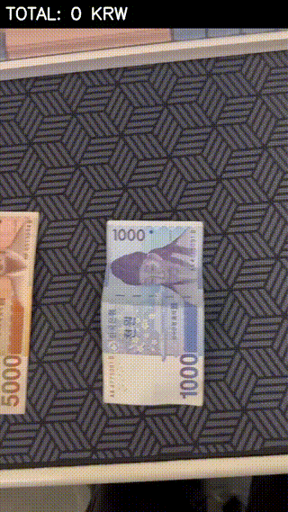
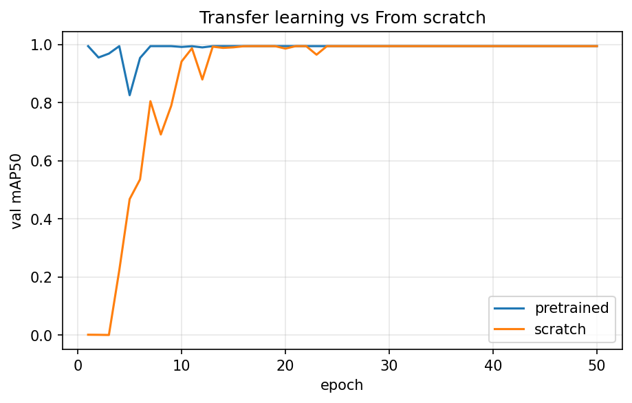

# YOLO11 한국 지폐 인식 (1000원 / 5000원 / 10000원)

COCO 사전학습 YOLO11n을 3개 부류(1000원, 5000원, 10000원) 지폐 데이터로 fine-tuning 하고,
동영상에서 지폐를 **탐지 + 추적(ByteTrack) + 궤적 표시 + 총 금액 계산**한 프로젝트입니다.
(충북대학교 머신러닝 과제 2)



## 결과 (테스트 69장)

| 실험 | Precision | Recall | mAP50 | mAP50-95 | AP 1000원 | AP 5000원 | AP 10000원 |
|---|---|---|---|---|---|---|---|
| **pretrained (전이학습)** | 0.997 | 1.0 | 0.995 | **0.995** | 0.995 | 0.995 | 0.995 |
| scratch (처음부터 학습) | 0.997 | 1.0 | 0.995 | 0.969 | 0.995 | 0.991 | 0.921 |



- 사전학습 모델은 첫 epoch부터 val mAP50 ≈ 1.0, 처음부터 학습한 모델은 약 13 epoch 이후 도달
- 테스트 69장 중 오류 0장

## 방법

1. **데이터 수집**: 지폐 종류별로 동영상 직접 촬영 → 영상당 약 200프레임 추출
2. **자동 라벨링**: Open-vocabulary 탐지 모델 YOLO-World로 `banknote` 위치 탐지 → 영상의 부류 번호 부여
3. **분할**: 데이터 누수 방지를 위해 시간 구간으로 train 70% / valid 20% / test 10%
4. **학습**: YOLO11n, 50 epochs, imgsz 640, `hsv_h=0`(색이 핵심 특징), `fliplr=0`(반전된 지폐는 없음)
5. **추적**: ByteTrack + 중심점 궤적 + 화면 속 지폐 금액 합산

## 파일

| 파일 | 설명 |
|---|---|
| `best.pt` | 학습된 모델 (YOLO11n, 3 classes) |
| `result.mp4`, `result.gif` | 시연 영상 결과 |
| `YOLO11_korean_banknote_fast.ipynb` | Colab 노트북 |
| `compare.csv`, `compare_curve.png` | 전이학습 vs 처음부터 학습 비교 |
| `results.png`, `confusion_matrix_pretrained.png` | 학습 지표 |
| `trajectory.csv` | 추적 ID별 궤적 좌표 |

## 사용법

```python
from ultralytics import YOLO
model = YOLO('best.pt')
model.track('video.mp4', tracker='bytetrack.yaml', save=True)
```
